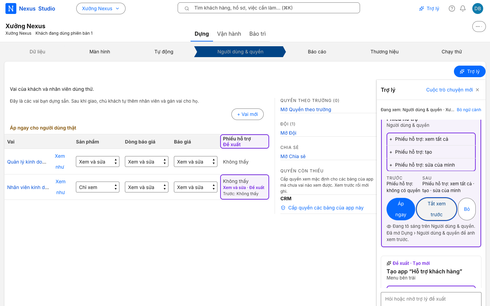
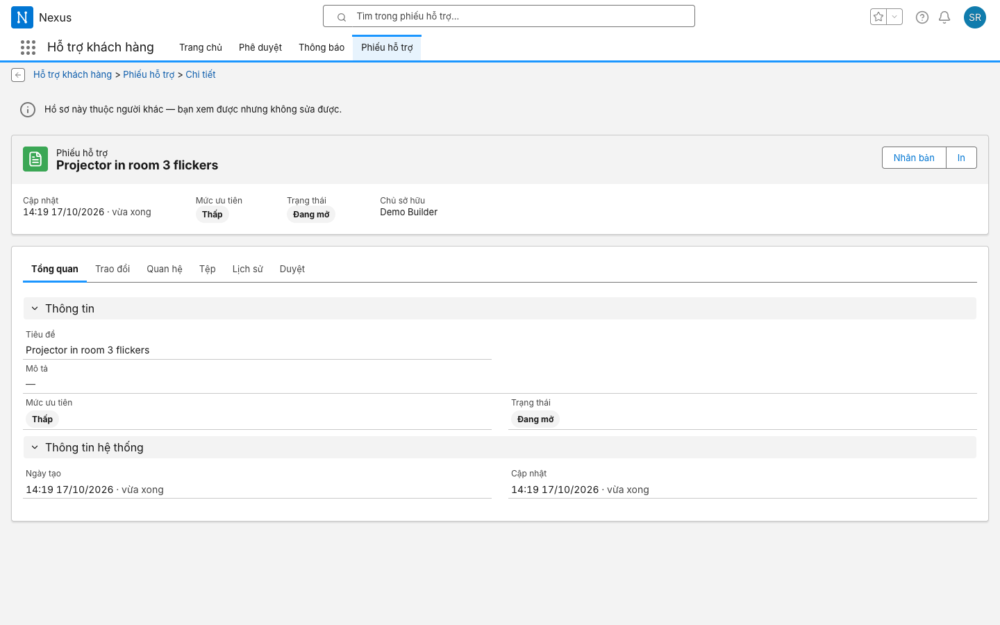
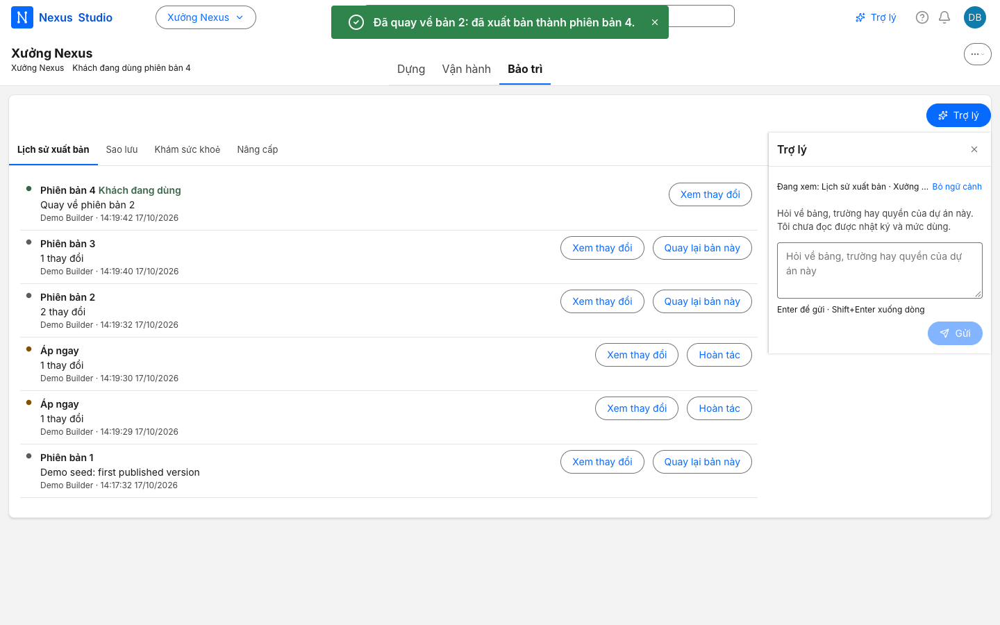
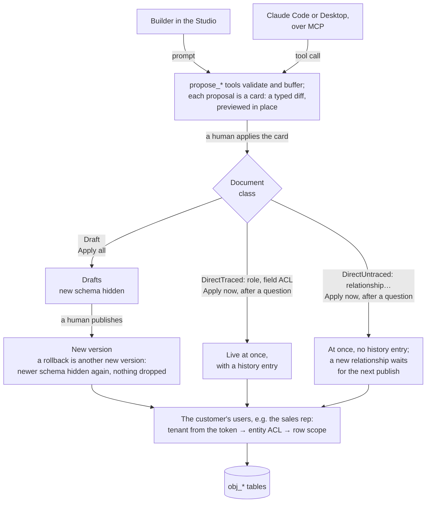

# Nexus

An agent-native platform for business apps. Agents never write application code. They edit a typed, versioned,
permissioned model of the app (tables, fields, relations, layouts, workflows, access), and every change they propose
is a reviewable diff that a human applies. Most changes wait as drafts until a human publishes them, any published
version can be rolled back, and access is enforced per tenant and per row for the people who use the app. Outside
agents (Claude Code, Claude Desktop) get the same read and propose tools over MCP: **agents propose, humans dispose.**


One replayed run of [`demo-loop.mjs`](nexus-web/scripts/demo-loop.mjs): the 18 steps that CI runs in Chrome on
every code change, with the model's answer read from [a recorded cassette](cassettes/demo-loop.jsonl), so no model
and no key. 80 seconds; the UI is Vietnamese-first, the captions are English.

<details>
<summary>Three stills, for readers who skip the GIF</summary>


*The AI's access card for the sales reps, previewed as ghost cells on the access matrix ("Đề xuất" means proposed).*


*The rep on the builder's ticket: "this record belongs to someone else: you can view it but not edit it", no Edit.*


*After the rollback: version 4 republishes version 2; the changes applied at once ("Áp ngay") keep their Revert.*

</details>

## Why Nexus

AI app builders that generate code leave one codebase per app to review and maintain. Classic low-code runs a model
instead, but was built for a person in a visual editor. Nexus keeps the model and makes it the agent's interface.

| | Code-generating app builders | Classic low-code | Nexus |
|---|---|---|---|
| Who changes the app | an agent, by writing code | a person, in a visual editor | an agent proposes; a person applies |
| What a reviewer reads | a code diff | the change in the editor | a typed diff of one document (a table, a field, a layout, a grant), previewed in place |
| What runs the app | its own generated codebase | the platform's engine | one human-maintained engine for every app |
| Where a runtime fix lands | in each codebase | once, in the engine | once, in the engine |
| Access rules | written and proven per app | the platform's model | `tenant_id` on every query, entity ACL, row scope |
| What it gives up | a codebase per app to keep healthy | an interface built for agents | whatever the engine cannot express: custom logic is Go work |

## How it works

The loop and its boundary, as [ADR 0002](docs/adr/0002-schema-cutoff-drafts-and-rollback.md) and
[ADR 0003](docs/adr/0003-agent-boundary-from-change-classes.md) define them:



- [ADR 0001](docs/adr/0001-metadata-is-the-agent-action-space.md): the agent's action space is 26 typed tools, 11 that
  read and 15 `propose_*` that validate a change, with the manual builder's validators where one exists, and buffer
  it. None applies, publishes, writes or takes a tenant.
- [ADR 0002](docs/adr/0002-schema-cutoff-drafts-and-rollback.md): one class table decides how an applied change
  reaches users. Publish is one transaction; a new table or field exists at once but stays hidden behind the schema
  cutoff. A rollback re-hides newer schema, drops nothing, and leaves applied-at-once changes to Revert.
- [ADR 0003](docs/adr/0003-agent-boundary-from-change-classes.md): a card follows its class. Drafts go in "Apply all";
  access, relationships, a new app and records are "Apply now", after a question. `/mcp` serves the same tools to a
  key that a builder issues, that works on `/mcp` only and that lasts at most 8 hours.
- [ADR 0004](docs/adr/0004-sqlx-for-dynamic-records-gorm-for-system-tables.md): records live in one `obj_<entity>`
  table per entity name, shared by tenants; sqlx with allowlisted identifiers there, GORM for fixed-shape tables.
- [ADR 0005](docs/adr/0005-tenant-isolation-and-row-level-access.md): every query filters `tenant_id`, entity ACL runs
  before the handler and row scope in the repository; the end-user assistant reads through the same checks, as the
  user who asks. Admins skip ACL, so acceptance runs as the non-admin rep.

## Try it

### Quickstart

```bash
docker compose up --build
```

Open <http://localhost:8080> (set `NEXUS_PORT` to use another port). Workspace code: `northwind`.

| Who | Email | Password | Sees |
|---|---|---|---|
| Builder (Studio) | `admin@example.com` | `Demo-Admin-2026!` | everything, edits as drafts |
| Sales rep | `test@example.com` | `Demo-Rep-2026!` | only what the published version and their role allow: every account, plus their own book: Globex's contact, deal, activity, quote and its lines, contract, and two leads |

These credentials are for your laptop only; [`docker-compose.yml`](docker-compose.yml) documents every override. The
builder agent needs an OpenAI-compatible gateway: set `AI_ENABLED=true` and `AI_GATEWAY_BASE_URL`, or replay a
recorded cassette as below.

### The demo loop, replayed (no model, no key)

```bash
AI_ENABLED=true AI_GATEWAY_MODE=replay AI_GATEWAY_CASSETTE=/cassettes/demo-loop.jsonl docker compose up --build -d
docker wait nexus-seed-1        # prints 0 once the seed has published version 1
(cd nexus-web && npm ci && node scripts/demo-loop.mjs ../demo-loop-shots)
docker compose down -v          # a replayed stack answers one run
```

It prints one `ok` line per step and saves one screenshot per step; the first failing step exits 1. Set `CHROME_PATH`
if Chrome is not found, and `NEXUS_PORT` for both commands if 8080 is taken.

### Connect Claude Code over MCP

1. In the Studio, open **Vận hành › Việc tự động & kết nối › Khoá truy cập** and, under **Kết nối agent (MCP)**, click
   **Tạo khoá cho agent**. The key is shown once, lasts at most 8 hours, and comes with the line to run:
   `claude mcp add --transport http nexus http://localhost:8080/mcp --header "Authorization: Bearer nxm_…"`
2. Ask Claude Code for a change, for example "Add a Suppliers table with name, email, phone and a rating from 1 to 5".
3. Back in the Studio, click **Mở cuộc trò chuyện** on that key: the proposal is a card. Apply it, then publish.

The key acts as the builder who created it and can be revoked from the same list. The server needs no model of its
own for this, so `AI_ENABLED` can stay off. [`mcp-loop.mjs`](nexus-web/scripts/mcp-loop.mjs) runs this loop end to
end, and [`evals/mcp/`](evals/mcp/README.md) measures it on five requests.

## Read these files first

Paths under `internal/` are in `nexus-platform/`.

- [`internal/ddl/ddl.go`](nexus-platform/internal/ddl/ddl.go): the allowlist every table and column name passes
  before it enters SQL (`^[a-z][a-z0-9_]{0,25}$`, no reserved words), since identifiers cannot be `?` parameters.
- [`internal/dynrepo/rowscope.go`](nexus-platform/internal/dynrepo/rowscope.go): row scope as a parameterized
  predicate after the tenant filter: all, team, owner, a user field, shares on reads. An unknown level matches no row.
- [`internal/middleware/acl.go`](nexus-platform/internal/middleware/acl.go): entity ACL before the handler; the HTTP
  method maps to view, create, edit or delete, denied by default, with one 403 for every refusal. Admins skip it.
- [`internal/services/publish_service.go`](nexus-platform/internal/services/publish_service.go): publish as one
  transaction under a lock on the tenant row; the reviewed change set, the version and the draft cleanup commit
  together.
- [`internal/metaversion/class.go`](nexus-platform/internal/metaversion/class.go): the class table, which document
  types go through drafts, which apply at once with a history entry and which apply at once without one.
- [`internal/ai/tools.go`](nexus-platform/internal/ai/tools.go) and
  [`tools_access.go`](nexus-platform/internal/ai/tools_access.go): the builder agent's tools. `propose_access` grants
  only view, create or edit, only additively, and only on a table proposed in the same turn or not yet published.
- [`internal/mcpserver/`](nexus-platform/internal/mcpserver/): `/mcp`, the same tools filtered to read and propose
  verbs, run as the builder who issued the key; a proposal lands in that builder's Studio thread.
- [`nexus-web/lib/aiApply.ts`](nexus-web/lib/aiApply.ts): how the browser applies a card of each of the 15 kinds,
  through the same admin APIs as a manual edit. The question before an at-once change is a client rule.

## Numbers

[](https://github.com/doxuta/nexus/actions/workflows/ci.yml?query=branch%3Amain)

[CI](.github/workflows/ci.yml) runs five jobs on every push to `main` and every pull request that touches code: Go
(vet, gofmt, `test -race`, build), Go integration on MySQL 8, web (build, tsc, vitest, eslint), the one-command
demo, and the replayed demo loop in Chrome.

Measured on 2026-10-17 at `e0862c1`:

| What | Result | Command |
|---|---|---|
| Go unit tests | 3,873 tests (9,603 with subtests) in 42 packages, 0 failed | `go test ./... -count=1 -json` in `nexus-platform/` |
| Go tests on a real MySQL 8 | 4,987 tests (11,215 with subtests) in 49 packages, 0 failed, 0 skipped | `bash scripts/run-integration.sh ./... -race -timeout 50m -p 2` in `nexus-platform/` |
| Web unit tests | 6,214 tests in 583 files, 0 failed | `npx vitest run` in `nexus-web/` |
| The demo loop, replayed | 18 of 18 steps | `node scripts/demo-loop.mjs <dir>` in `nexus-web/`, as above |
| Size | 161,537 lines of Go and 113,083 of TypeScript, tests excluded | `wc -l` over the tracked non-test `*.go`, `*.ts` and `*.tsx` files |

The MySQL run builds with `-tags=integration`, so it includes the unit tests: 1,114 of its 4,987 tests exist only
under that tag. [`run-integration.sh`](nexus-platform/scripts/run-integration.sh) printed `PASS=11215 SKIP=0`; it
fails any run where a test skips.

- **MCP tool-use eval: 5 of 5.** Five plain requests to Claude Code connected over MCP, graded by code on the
  proposals that reach the Studio; one run each, `claude-opus-5-5`, recorded on 2026-10-17
  ([results](evals/mcp/README.md)).
- **builder-bench: 20 requests, scored in five stages by code** (the right kinds of change; the cards apply; the
  version publishes; the gate passes as the non-admin rep; the rep opens the tables). `claude-haiku-5-5`: pass@1
  0.85, pass@3 0.90 over 60 attempts. `claude-opus-5-5`: pass@1 0.85 over 20. When the proposal had the right kinds,
  apply and publish each failed once in 66 attempts, and the rep's checks never failed. Each failure is explained from
  its transcript; two of the three failing requests are engine gaps, not model errors
  ([report](evals/builder-bench/report.md)). About 2,000–2,700 output tokens per working app.

## How it was built

Lights on, not a dark factory ([`AGENTS.md`](AGENTS.md)): one vertical slice per PR, checked as the non-admin rep;
a [builder agent](.claude/agents/builder.md) writes the tests red first; a [verifier agent](.claude/agents/verifier.md)
with a fresh context tries to refute the PR, and a confirmed HIGH or MEDIUM blocks the merge; every guard is broken
once to watch its test fail. Before merge, the verifier found a privilege-escalation path in
[#21](https://github.com/doxuta/nexus/pull/21) (a proposed table named after a live one let `propose_access` grant on
the live table), a HIGH in [#20](https://github.com/doxuta/nexus/pull/20) (MCP agents read the published model, not
the builder's drafts, so applying a card would have reverted pending edits), and a demo that contradicted its own
prompt in [#16](https://github.com/doxuta/nexus/pull/16). The long version, with what it cost and what the verifiers
missed: [Turning the lights back on](docs/writeup/turning-the-lights-back-on.md).

## Security

The threat model is in [`SECURITY.md`](SECURITY.md): who can do what, the trust boundaries, prompt injection, the
human gate and its limits, and the known gaps. Report a vulnerability privately, through **Report a vulnerability**
on this repository's Security tab.

## Status and limits

- **Runs today:** the one-command demo; the metadata engine (tables, fields, relations, layouts, workflows, reports);
  drafts, publish and rollback; entity ACL and row scope; five installable packs (CRM, which the seed installs,
  Clinic, Ticketing, LMS, Project Management); the Studio's builder agent and the end-user assistant, which need a
  model gateway or a recorded cassette; and `/mcp`. There are no releases: `main` is the product.
- **Next, in the open:** an eval of the agent harness ([#5](https://github.com/doxuta/nexus/issues/5)), the
  engine gaps builder-bench found ([#30](https://github.com/doxuta/nexus/issues/30)) and the rest of the
  [issues](https://github.com/doxuta/nexus/issues).
- **Frozen:** the packs beyond the demo, approvals (`internal/bpm`), work queues, dashboards, calendars, per-tenant
  backup (`internal/tenantbackup`) and the Doctor (`internal/doctor`) are in the tree and tested in CI, but no open
  issue extends them.
- **Vietnamese first.** The English catalog holds 219 of the 6,710 keys in `nexus-web/lib/i18n`, and older screens
  still hold Vietnamese literals; [#6](https://github.com/doxuta/nexus/issues/6) measures the demo path first.
- **Rollback re-hides; it does not delete** ([ADR 0002](docs/adr/0002-schema-cutoff-drafts-and-rollback.md)).
  Schema born after the target is hidden again and its rows stay; attribute edits of a field or table are not
  reverted; changes applied at once are undone one entry at a time with Revert.
- **Isolation is a convention plus tests**, not database-level security
  ([ADR 0005](docs/adr/0005-tenant-isolation-and-row-level-access.md)).
- **Open issues that matter:**
  - [#18](https://github.com/doxuta/nexus/issues/18): a record the rep can read but not edit answers `PUT` with 404,
    not 403.
  - [#13](https://github.com/doxuta/nexus/issues/13): a schema insert still uncommitted when a publish re-reads can
    slip past its cutoff, and the cutoff's one-second wait runs under the tenant lock. The same-second leak itself is
    fixed ([#33](https://github.com/doxuta/nexus/pull/33)).
  - [#22](https://github.com/doxuta/nexus/issues/22): `/mcp` has no rate limit and no cap on turns per thread, and its
    tool filter is a naming rule.
  - [#23](https://github.com/doxuta/nexus/issues/23): a table that is still hidden can be reached through N-N links
    and `?expand` with a crafted call and a granted role, and `PUT /admin/roles/:id` carries no version.

## License

[MIT](LICENSE). Third-party notices: [`THIRD_PARTY_NOTICES.md`](THIRD_PARTY_NOTICES.md).
